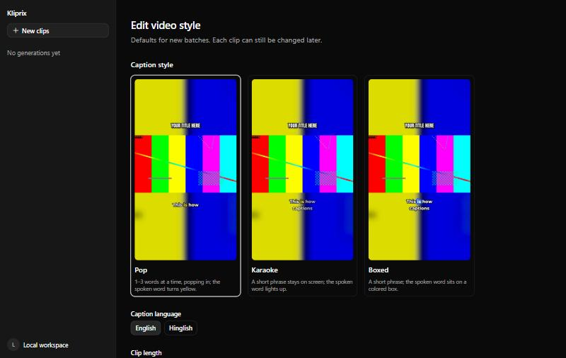

# Kliprix

Kliprix turns up to **3 video links** (YouTube in v1) into up to **5 vertical shorts each**
(1080x1920, 30 fps, H.264 + AAC): a blurred background, the main video framed on the face
(or the full frame), a short title on top and animated captions below. It finds the moments
itself from chat activity, audio energy, motion and the transcript, and uses **your own LLM**
(Gemini, Claude, OpenAI, OpenRouter or any OpenAI-compatible server) to pick clips and write
titles, descriptions, hashtags and a LinkedIn post.

Everything runs **on your computer**. There is no account, no hosting and no telemetry.

| Home | Edit video style | Settings |
|---|---|---|
|  |  |  |

## Requirements

| What | Version | Install |
|---|---|---|
| Python | **3.11 or 3.12** (3.13+ is not supported yet by some dependencies) | Windows: [python.org](https://www.python.org/downloads/) or `winget install Python.Python.3.12` · macOS: `brew install python@3.12` · Linux: your package manager (`python3.12`, `python3.12-venv`) |
| Node.js | **22 or newer** (also used by the downloader for YouTube) | [nodejs.org](https://nodejs.org/) LTS · Windows: `winget install OpenJS.NodeJS.LTS` · macOS: `brew install node@22` |
| FFmpeg + ffprobe | any recent build **with libass** | Windows: `winget install Gyan.FFmpeg` (or a "full"/"essentials" build from gyan.dev) · macOS: `brew install ffmpeg` · Ubuntu/Debian: `sudo apt install ffmpeg` |
| RAM | 4 GB minimum, 8 GB+ recommended | |
| Disk | a few GB free (long streams are 1–3 GB each) | |

An NVIDIA GPU is optional: transcription uses it when the CUDA libraries are installed and
falls back to the CPU otherwise.

Check your machine at any time:

```
python scripts/doctor.py
```

It reports Python, Node, ffmpeg/ffprobe, libass, RAM and disk, with a fix hint for every problem.

## Start

Clone or download this repository, then run **one command** from its folder:

- Windows: double-click `scripts\start.bat`, or run `scripts\start.bat` in a terminal
- macOS / Linux: `./scripts/start.sh`

The first start creates the Python environment, installs dependencies and builds the
frontend (this takes several minutes and downloads about 1.5 GB of packages). Later starts
skip what has not changed. Kliprix opens at **http://127.0.0.1:3000**. Press **Ctrl+C** in
the terminal to stop it.

Speech models (faster-whisper; Parakeet, 480 MB) and the face detector model download once on first
use into `data/models/`.

Speech-to-text: English captions use **Parakeet** (NVIDIA Parakeet-TDT-0.6b-v2 via sherpa-onnx,
about 4x faster than Whisper `medium` on a 6-core CPU) on PCs with 8 GB of RAM or more; Hinglish
and smaller PCs use Whisper. Change it in Settings → Transcription. Each video shows which engine
ran; if Parakeet fails (for example no internet for its first download), Whisper takes over for
that video and the note says why.

## Get an API key

Kliprix calls your LLM once per video to pick clips (and once per clip for Hinglish captions).
Free tiers are enough for normal use.

- **Gemini**: [Google AI Studio](https://aistudio.google.com/apikey) → "Create API key".
- **Claude**: [Anthropic Console](https://console.anthropic.com/) → API keys.
- **OpenAI**: [OpenAI platform](https://platform.openai.com/api-keys).
- **OpenRouter**: [openrouter.ai/keys](https://openrouter.ai/keys).
- **OpenAI-compatible**: any server with the OpenAI API (for example a local LM Studio or
  llama.cpp server); enter its base URL, e.g. `http://127.0.0.1:1234/v1`.

In Kliprix: open the menu at the bottom of the sidebar → **Configure API** → choose the
provider → paste the key → **Load models** → choose a model (or type its id) → **Test
connection** → **Save for this session**.

## How to use

1. On **Home**, paste a link and press **Add** (up to **3 videos**). Each card shows the
   title, length and whether a chat replay exists.
2. Optional: **Edit video style** sets the defaults: caption style, English or Hinglish
   captions, clip length (30–60 s, or up to 90 s when a moment needs it), **clips per video
   (1–5)**, background blur, crop (Auto / Face / Full frame) and title on/off.
3. Press **Start**. The batch page shows each video's steps live (download, chat replay,
   audio and motion, highlights, transcription, picking clips, editing) and every clip's
   status. Videos are processed one after another and clips one at a time.
4. Open a finished clip to watch it, copy its metadata, and edit it.

### Caption styles
- **Pop**: 1–3 words at a time pop in; the spoken word turns yellow.
- **Karaoke**: a short phrase stays on screen; the spoken word lights up, upcoming words are dimmed.
- **Boxed**: a short phrase; the spoken word sits on a colored box.

The examples on the style page are rendered by Kliprix itself.

### Editing and export
On a clip: **Metadata** (on-video title, YouTube title and description, hashtags, LinkedIn
post, why the moment was picked) saves as you leave a field; each has a **Copy** button.
**Edit** changes trim (start/end inside the available range), caption style, caption words,
blur and crop; press **Apply changes**, then **Preview** (a quick 540x960 render) to see
them. **Export** renders full quality, and **Download** saves the file through your browser.

### Hinglish
Hinglish captions are Hindi written in English letters ("Namaste kaise ho aap?"). Whisper
often writes Hindi in Devanagari; Kliprix asks your LLM to convert each word while keeping
the timing. If that fails, captions stay in Devanagari with a bundled Devanagari font.

## Where files are stored
Everything lives in `data/` (or the folder in the `DATA_DIR` environment variable):

| Folder | Content |
|---|---|
| `data/exports/<batch>/<video>/clip_01_<title>.mp4` | Finished clips |
| `data/previews/` | Preview renders |
| `data/downloads/<video>/` | Source video, audio, chat, signals, transcript, selection |
| `data/work/<clip>/` | Cut and crop files (with 5 s editing handles) |
| `data/models/` | Speech and face models |
| `data/db/app.sqlite` | History and settings |
| `data/logs/app.log` | Log file (never contains API keys) |

**Settings → Storage** shows the size of each folder and can delete source videos,
previews or work files. "Source videos after processing" can be **Ask** (default), **Delete**
or **Keep**. A banner appears when the data is larger than the warning size (default 10 GB).
Tip: keep `DATA_DIR` outside folders synced by OneDrive/Dropbox; sync tools can lock big files.

## Docker (optional)
```
docker compose up --build
```
Then open http://127.0.0.1:3000. Data is kept in `./data`. Both ports are published on
127.0.0.1 only. **Low-RAM warning:** Docker Desktop itself needs about 2 GB of RAM, so on a
4 GB machine use the start scripts instead.

## Troubleshooting
- **ffmpeg not found / no libass**: install ffmpeg (see Requirements), open a new terminal, run
  `python scripts/doctor.py`. If ffmpeg is installed somewhere else, set `FFMPEG_PATH` to the
  full path of `ffmpeg`.
- **Downloads fail or "the downloader is outdated"**: YouTube changes often. Settings →
  **Update downloader**, then restart Kliprix.
- **Age-restricted or members-only videos**: not supported in v1 (no login/cookies); the
  video fails with a clear message and the others continue.
- **Out of memory / very slow on a 4 GB PC**: choose a smaller Whisper model in Settings
  (`tiny` or `base`), close other apps, and process fewer or shorter videos. Downloads are
  capped at 720p below 6 GB RAM.
- **Hinglish accuracy**: Whisper's Hindi recognition is weaker than English; check the
  captions in the editor and fix words there.
- **"The AI model is not configured" after a restart**: the key is kept in memory only. With
  the browser tab still open it is re-sent automatically; otherwise configure it again.
- **Port 3000 or 8000 is busy**: stop the other program using it.

## Performance (measured, not promised)
On the development PC (16 GB RAM, Windows 11, GTX 1650 without CUDA libraries, so
transcription ran on the CPU):

| Step | Input | Time | Peak memory |
|---|---|---|---|
| Audio + motion signals | 15-min 1080p60 gaming stream | 2 min | 0.2 GB |
| Audio + motion signals | 101-min 1080p60 stream | 12 min (motion 645 s) | 0.2 GB |
| Transcription, `medium` (CPU) | whole 15-min video | 9.3 min | 2.0 GB |
| Transcription, `base` (CPU) | 23 min of candidate spans in a 101-min stream | 3.2 min | 0.7 GB |
| Render one 48 s clip (face crop) | 1080p60 source | 1.5 min | 0.9 GB incl. ffmpeg, with the 4 GB-tier thread limit |

A measurement on a low-spec (4 GB) machine is still to be added.

## Privacy
- Your API key stays in this browser tab (session storage) and in the backend's memory. It is
  never written to disk, logs or the database, and it is sent only to your chosen provider.
- The only network traffic is: the video platform (download and chat replay), your LLM
  provider, and one-time package/model downloads during setup.
- No analytics or telemetry (Next.js, FastAPI, Hugging Face and LiteLLM telemetry are switched off).

## Responsibility
You are responsible for having the rights to the videos you clip and for following the
platform's terms of service.

## License
MIT (see `LICENSE`). Third-party components and their licenses: `THIRD_PARTY_NOTICES.md`.

## Contributing
Read `docs/00-README-FOR-AI.md` (it applies to people too): the specs in `docs/` are the
source of truth, `docs/14-decisions-log.md` wins over the other docs, and every change keeps
lint, types and tests green:

```
cd backend && .venv/Scripts/ruff.exe check . && .venv/Scripts/mypy.exe && .venv/Scripts/python.exe -m pytest
cd frontend && npm run lint && npm run typecheck && npm test
```
(on macOS/Linux the venv tools are in `.venv/bin/`). CI runs the same checks on every push.
