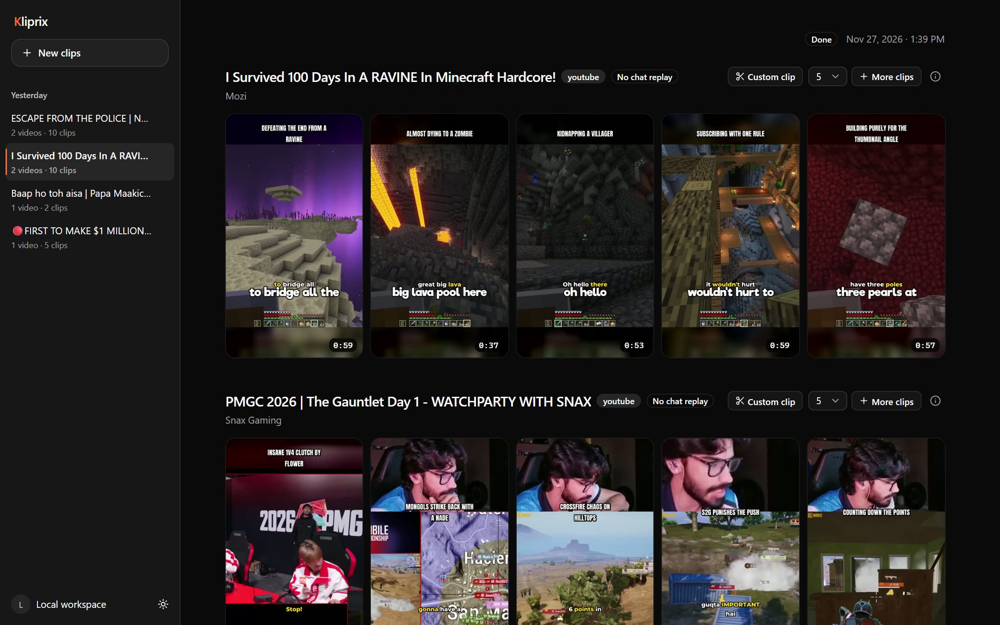
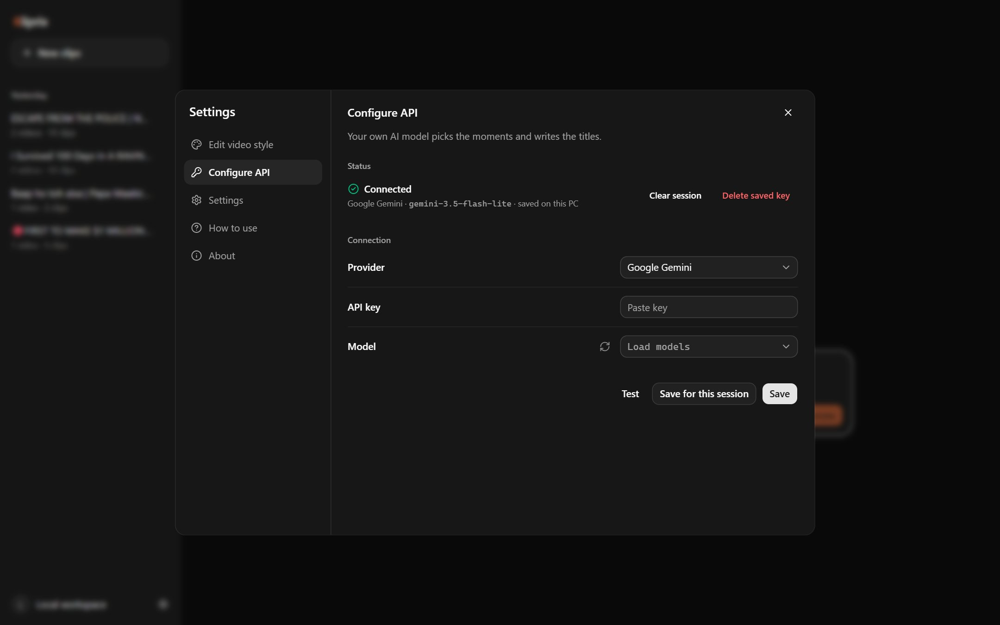
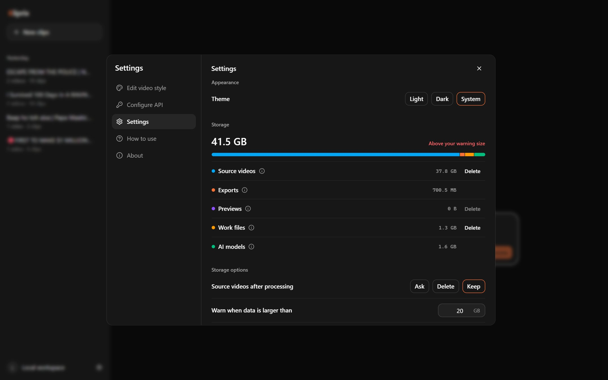

# Kliprix

**Long videos in. Shorts worth posting out.**

Paste up to 3 YouTube links and get up to 5 vertical shorts from each, with captions,
a title and ready-to-post text. Everything runs on your computer; only your own AI model
(Gemini, Claude, OpenAI, OpenRouter or any OpenAI-compatible server) is called.


## Features

- Finds the best moments by itself (chat, sound, motion, on-screen text, transcript + your AI).
- Frames the speaker's face, or the facecam + game for gaming videos.
- Animated captions in 3 styles: Pop, Karaoke, Boxed. Bad words are censored.
- Writes the title, YouTube description and hashtags for every clip.
- Timeline editor: trim, split, delete, edit caption words, blur boxes, live preview.
- **More clips** and **Custom clip** from a video you already downloaded.
- Pause, resume or cancel a batch; resume a failed video where it stopped.
- No account, no hosting, no telemetry. Runs on 4 GB RAM.

## Screenshots

| Batch page | Clip and metadata |
|---|---|
|  |  |
| **Timeline editor** | **Edit video style** |
|  |  |
| **Configure API** | **Settings** |
|  |  |

## Requirements

- Python **3.11 or 3.12** (not 3.13+)
- Node.js **22+**
- FFmpeg (with libass)
- Git
- 4 GB RAM (8 GB+ recommended), 5 GB+ free disk
- NVIDIA GPU: optional, used when present

## Installation

**1. Install the requirements** (one line, then open a new terminal):

Windows (PowerShell):
```powershell
winget install -e --id Python.Python.3.12; winget install -e --id OpenJS.NodeJS.LTS; winget install -e --id Gyan.FFmpeg; winget install -e --id Git.Git
```

macOS:
```
brew install python@3.12 node ffmpeg git
```

Ubuntu / Debian:
```
sudo apt update && sudo apt install -y python3.12 python3.12-venv nodejs npm ffmpeg git
```
(If `node -v` shows lower than 22, install Node from [nodejs.org](https://nodejs.org/).)

**2. Get the code:**
```
git clone https://github.com/sandeshlawhale/Kliprix.git
cd Kliprix
```

**3. Check your machine** (optional):
```
python scripts/doctor.py
```

**4. Start Kliprix:**
- Windows: `scripts\start.bat` (or double-click it)
- macOS / Linux: `./scripts/start.sh`

The app opens at **http://127.0.0.1:3000**. Stop it with **Ctrl+C**.

- The first start takes several minutes (installs ~1.5 GB of packages and builds the app).
- Later starts are fast.
- To update: `git pull`, then start again.

## Connect your AI model

1. Get a free API key:
   [Gemini](https://aistudio.google.com/apikey) ·
   [Claude](https://console.anthropic.com/) ·
   [OpenAI](https://platform.openai.com/api-keys) ·
   [OpenRouter](https://openrouter.ai/keys) ·
   or a local OpenAI-compatible server (e.g. LM Studio: `http://127.0.0.1:1234/v1`).
2. In Kliprix: **Local workspace** (bottom of the sidebar) → **Configure API**.
3. Choose the provider, paste the key, load and pick a model, press **Test**.
4. **Save** keeps it encrypted on this PC. **Save for this session** forgets it on restart.

## How to use

1. **Paste** up to 3 YouTube links on Home.
2. Optional: **Edit style** → caption style, clips per video (1–5), title on/off.
3. Press **Process** and watch the live steps on the batch page.
4. **Open a clip** → copy the title, description and hashtags.
5. Optional: **Edit** → trim, split (`S`), delete parts, fix captions, add blur boxes → **Apply changes**.
6. **Download** the final video.

Tips:
- **More clips** gets extra clips from the same video, no new download.
- **Custom clip** lets you pick any range (5–90 s) yourself.
- A failed video shows **Resume**; finished steps are kept.

## Where files are stored

All in `data/`:
- `data/exports/` – finished clips
- `data/downloads/` – source videos
- `data/models/` – speech and detection models
- `data/logs/app.log` – log file (never contains API keys)

Clean up space in **Settings → Storage**.

## Troubleshooting

- **ffmpeg not found** → install it, open a new terminal, run `python scripts/doctor.py`.
- **Downloads fail** → **Settings → Downloader → Update**, then restart.
- **"AI model is not configured"** → set it up again, or use **Save** instead of session save.
- **AI / rate-limit error** → check your key and quota, then press **Resume** on the video.
- **Private / members-only / age-restricted videos** → not supported.
- **Slow on a 4 GB PC** → close other apps, use fewer or shorter videos.
- **Port 3000 or 8000 busy** → close the other program using it.

## Docker (optional)

```
docker compose up --build
```
Open http://127.0.0.1:3000. Not recommended on 4 GB RAM machines.

## Privacy

- Your API key is never stored in plain text, never logged, and only sent to your provider.
- Network use: the video download, your AI provider, one-time package/model downloads,
  and a yt-dlp update check while Settings is open.
- No analytics or telemetry.

## Development

- `backend/` – FastAPI (Python), `frontend/` – Next.js, `scripts/` – launcher, `docs/` – specs.
- Read `docs/00-README-FOR-AI.md` before contributing.
- Checks (CI runs the same):
  ```
  cd backend && .venv/Scripts/ruff.exe check . && .venv/Scripts/mypy.exe && .venv/Scripts/python.exe -m pytest
  cd frontend && npm run lint && npm run typecheck && npm test
  ```
  (macOS/Linux: `.venv/bin/`)

## License

MIT (see `LICENSE`). You are responsible for having the rights to the videos you clip.
Third-party licenses: `THIRD_PARTY_NOTICES.md`.
