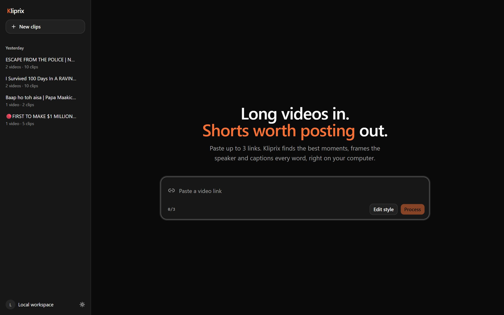
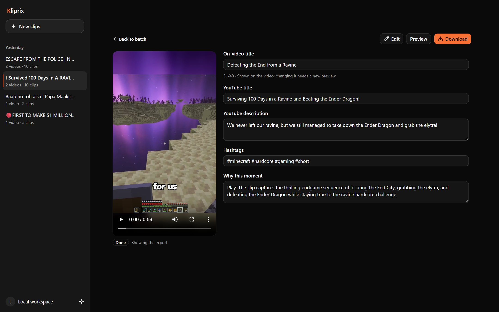
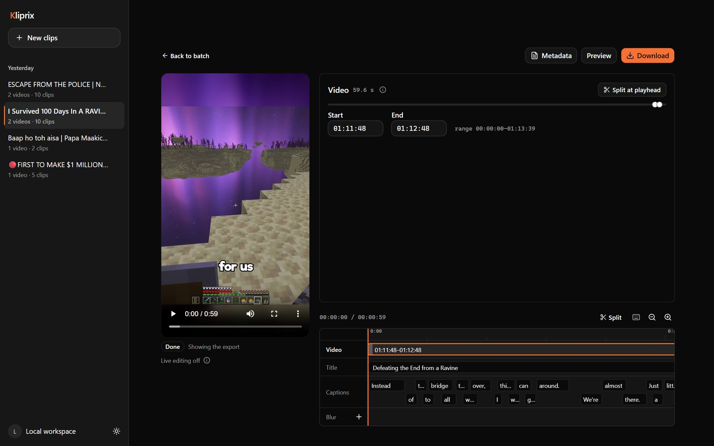

# Kliprix

**Long videos in. Shorts worth posting out.**

Kliprix turns up to **3 YouTube videos** into up to **5 vertical shorts each**
(1080x1920, 30 fps, H.264 + AAC). It finds the best moments by itself, frames the speaker
or the game, puts a short title on top and animated captions on every word, and writes the
YouTube title, description and hashtags for each clip. You review, tweak in a small
timeline editor, and download.

Everything runs **on your own computer**. There is no account, no hosting, no telemetry.
The only outside service is **your own AI model** (Gemini, Claude, OpenAI, OpenRouter or any
OpenAI-compatible server, local ones included), which picks the clips and writes the text.



## Contents

- [Features](#features)
- [Screenshots](#screenshots)
- [Requirements](#requirements)
- [Installation and first start](#installation-and-first-start)
- [Connect your AI model](#connect-your-ai-model)
- [How to use](#how-to-use)
- [Where files are stored](#where-files-are-stored)
- [Configuration](#configuration)
- [Docker (optional)](#docker-optional)
- [Troubleshooting](#troubleshooting)
- [Performance](#performance-measured-not-promised)
- [Privacy](#privacy)
- [Development](#development)
- [License](#license)

## Features

- **Finds the moments for you.** Chat replay activity, sound events, motion, on-screen text
  and the full transcript point to candidate moments; your AI model then picks the best
  ones, reviews each draft and makes sure every clip makes sense on its own (setup and
  payoff included, no sentence cut in half).
- **Layouts that fit the video.** Talking videos: the main video framed on the face over a
  blurred background. Gaming videos: the facecam on top with the game below, or the
  centre of the game when there is no facecam.
- **Animated captions** in three styles (Pop, Karaoke, Boxed), word-timed by on-device
  speech-to-text, with automatic censoring of bad words (stars in the text, a beep in the
  audio).
- **Ready-to-post text** for every clip: on-video title, YouTube title, description,
  hashtags and why the moment was picked, each with a copy button.
- **Timeline editor**: trim, split, delete and extend parts, edit caption words
  and the title, add blur boxes, with a live preview in the browser.
- **More clips / Custom clip**: ask for extra clips from a video you already processed, or
  pick any range yourself, without downloading again.
- **Pause, resume, cancel** a batch; **resume a failed video** from the step that failed.
- **Runs on modest PCs**: 4 GB RAM minimum, streams video frames instead of loading whole
  videos, and uses an NVIDIA GPU when one is there.

## Screenshots

| Batch page | Clip and metadata |
|---|---|
|  |  |

| Timeline editor | Edit video style |
|---|---|
|  |  |

| Configure API | Settings and storage |
|---|---|
|  |  |

## Requirements

| What | Version | Install |
|---|---|---|
| Python | **3.11 or 3.12** (3.13+ is not supported yet by some dependencies) | Windows: [python.org](https://www.python.org/downloads/) or `winget install Python.Python.3.12` · macOS: `brew install python@3.12` · Linux: your package manager (`python3.12`, `python3.12-venv`) |
| Node.js | **22 or newer** (runs the frontend, and yt-dlp uses it for YouTube) | [nodejs.org](https://nodejs.org/) LTS · Windows: `winget install OpenJS.NodeJS.LTS` · macOS: `brew install node@22` |
| FFmpeg + ffprobe | a recent build **with libass** | Windows: `winget install Gyan.FFmpeg` · macOS: `brew install ffmpeg` · Ubuntu/Debian: `sudo apt install ffmpeg` |
| Git | any | to clone the repository (or download the ZIP from GitHub) |
| RAM | 4 GB minimum, 8 GB+ recommended | |
| Disk | at least 5 GB free (packages and models), plus 1–3 GB per long stream | |

An **NVIDIA GPU is optional**. When one is found, the launcher installs NVIDIA's CUDA
libraries (about 630 MB) so Whisper runs on the GPU; every other PC uses the CPU.

Check your machine at any time:

```
python scripts/doctor.py
```

It reports Python, Node, ffmpeg/ffprobe, libass, RAM and disk, with a fix hint for every
problem.

## Installation and first start

1. **Install the requirements** above, then open a **new** terminal so they are on `PATH`.
2. **Get the code**:
   ```
   git clone https://github.com/sandeshlawhale/Kliprix.git
   cd Kliprix
   ```
3. **Start Kliprix** with one command from that folder:
   - Windows: double-click `scripts\start.bat`, or run `scripts\start.bat` in a terminal
   - macOS / Linux: `./scripts/start.sh`

The launcher (`scripts/run.py`) does everything:

- checks your machine (the same checks as `doctor.py`);
- creates the Python environment in `backend/.venv` and installs the backend packages;
- installs the CUDA libraries if you have an NVIDIA GPU;
- applies the database migrations;
- installs the frontend packages and builds the frontend;
- starts the backend on **127.0.0.1:8000** and the frontend on **127.0.0.1:3000**, and opens
  **http://127.0.0.1:3000** in your browser.

The **first start takes several minutes** and downloads about 1.5 GB of packages. Later
starts skip whatever has not changed, and rebuild only after an update. Press **Ctrl+C** in
the terminal to stop Kliprix. Use `--no-browser` to start without opening the browser
(`scripts\start.bat --no-browser`).

Some models download once, on first use, into `data/models/`: the speech-to-text model
(Parakeet, about 480 MB, or a Whisper model), the face detector, the sound and screen
classifiers.

**Updating:** `git pull`, then start again; the launcher installs and rebuilds what changed.

### Speech-to-text

Captions are made on your PC. PCs with **8 GB of RAM or more** use **Parakeet**
(NVIDIA Parakeet-TDT-0.6b-v2 via sherpa-onnx, about 4x faster than Whisper `medium` on a
6-core CPU). Smaller PCs use **Whisper**, with the model size picked from your RAM and GPU.
If Parakeet fails (for example no internet for its first download), Whisper takes over for
that video. The current step on the batch page shows which engine is running.

## Connect your AI model

Kliprix calls your AI model a few times per video to pick and review clips and write their
text. Free tiers are enough for normal use.

| Provider | Where to get a key |
|---|---|
| Gemini | [Google AI Studio](https://aistudio.google.com/apikey) → Create API key |
| Claude | [Anthropic Console](https://console.anthropic.com/) → API keys |
| OpenAI | [OpenAI platform](https://platform.openai.com/api-keys) |
| OpenRouter | [openrouter.ai/keys](https://openrouter.ai/keys) |
| OpenAI-compatible | any server with the OpenAI API, for example LM Studio or llama.cpp; enter its base URL, e.g. `http://127.0.0.1:1234/v1` |

In Kliprix: click **Local workspace** at the bottom of the sidebar → **Configure API**:

1. Choose the **Provider** and paste the **API key**.
2. Click the reload icon next to **Model** to load the models, then pick one (or type its
   id). The pin button keeps the models you use at the top of the list.
3. **Test** the connection.
4. **Save for this session** keeps the key in memory only (forgotten when the tab closes or
   Kliprix restarts). **Save** stores it encrypted on this PC together with the model, so it
   is ready on every start. **Delete saved key** removes it.

## How to use

The **How to use** tab in the settings dialog has the same steps in short form.

### 1. Make clips

1. On **Home**, paste a YouTube link; it is added at once (typed links: press Enter). Add up to **3 videos**. Each card shows
   the title, length and whether a chat replay exists.
2. Optional: **Edit style** sets the defaults for new batches: caption style, **clips per
   video (1–5)** and whether the title is shown on the video.
3. Press **Process**.

### 2. Follow the batch

The batch page shows each video's current step live (download, chat replay, signals,
highlights, transcription, picking clips, editing) with its percentage; hover the step and
click the arrow to see all 7. Clips appear as they finish. Videos are processed one after
another, clips one at a time.

- **Pause / Resume / Cancel** the batch from the top bar. A paused batch stays paused after
  a restart.
- **Resume from <step>**: when a video fails (for example "The AI model is busy"), resume it.
  Finished steps are reused, nothing downloads again.
- **More clips**: choose how many and get extra clips from the same video.
- **Custom clip**: play the downloaded video, select a range (5–90 s) and Kliprix makes a
  clip from it with captions, title and metadata, like the others.

Clip lengths follow the moment: usually 15–60 s, up to 90 s when a moment needs it.

### 3. Review, edit and download

Open a clip to watch it.

- **Metadata**: on-video title, YouTube title, description, hashtags and why the moment was
  picked. Fields save when you leave them; each has a copy button.
- **Edit** opens the timeline editor with tracks for the video, title, captions and blur:
  - drag the ends of a part to trim it or extend it into the source around it;
  - **Split** (or `S`) cuts the part under the playhead, **Delete** removes the selected part;
  - click a caption word to fix its text or time, or remove it;
  - add **blur boxes**: rectangles on the video with a from/to time;
  - with **Live** editing on, the title, captions and blur boxes are drawn over the video as
    you change them.

  **Apply changes** or **Discard** in the top bar; **Preview** renders a quick 540x960 version.
- **Download** saves the full-quality video. If there are unsaved or unrendered changes it
  renders first ("Preparing download…") and then downloads by itself.

### Caption styles

- **Pop**: 1–3 words at a time pop in; the spoken word turns yellow.
- **Karaoke**: a short phrase stays on screen; the spoken word lights up, upcoming words are dimmed.
- **Boxed**: a short phrase; the spoken word sits on a coloured box.

Bad words are censored in the rendered video (half the letters become `*` and the audio
beeps); the editor keeps the real text.

### Layouts

Kliprix chooses the layout from the video itself:

| Video | Layout |
|---|---|
| Talking, podcast, vlog | main video framed on the face (or the full frame) over a blurred background |
| Gaming with a facecam | facecam on top (1080x576), game below (1080x1344), title on the seam |
| Gaming without a facecam | the centre 3:4 of the game over a blurred background |

## Where files are stored

Everything lives in `data/` (or the folder in the `DATA_DIR` environment variable):

| Folder | Content |
|---|---|
| `data/exports/<batch>/<video>/clip_01_<title>.mp4` | Finished clips |
| `data/previews/` | Preview renders |
| `data/downloads/<video>/` | Source video, audio, chat, signals, transcript, selection |
| `data/work/<clip>/` | Cut and crop files (with 5 s editing handles) |
| `data/models/` | Speech, face, sound and screen models |
| `data/db/app.sqlite` | History and settings |
| `data/secret.key` | Encryption key for a saved API key |
| `data/logs/app.log` | Full log (never contains API keys) |

**Settings → Storage** shows how much space each folder uses and can delete source videos,
previews or work files. "Source videos after processing" can be **Ask** (default),
**Delete** or **Keep**. A banner appears when the data is larger than the warning size
(default 10 GB).

Tip: keep `DATA_DIR` outside folders synced by OneDrive or Dropbox; sync tools can lock
big files.

## Configuration

The defaults work for most people. To change them, copy `.env.example` to `.env` or set
environment variables:

| Variable | Default | Meaning |
|---|---|---|
| `DATA_DIR` | `./data` | Where downloads, clips, models and the database are kept |
| `BACKEND_HOST` / `BACKEND_PORT` | `127.0.0.1` / `8000` | Backend address |
| `ALLOWED_ORIGIN` | `http://localhost:3000` | Frontend origin allowed by the backend |
| `BACKEND_URL` | `http://127.0.0.1:8000` | Backend address used by the frontend |
| `LOG_LEVEL` | `INFO` | Level for `data/logs/app.log`. The terminal shows only warnings and errors; `DEBUG` shows everything in the terminal too |
| `FFMPEG_PATH` | empty | Full path to `ffmpeg` if it is not on `PATH` |

API keys never go in environment or `.env` files.

## Docker (optional)

```
docker compose up --build
```

Then open http://127.0.0.1:3000. Data is kept in `./data`, and both ports are published
on 127.0.0.1 only. **Low-RAM warning:** Docker Desktop itself needs about 2 GB of RAM, so on
a 4 GB machine use the start scripts instead.

## Troubleshooting

| Problem | Fix |
|---|---|
| **ffmpeg not found / no libass** | Install ffmpeg (see Requirements), open a new terminal, run `python scripts/doctor.py`. If ffmpeg is somewhere else, set `FFMPEG_PATH`. |
| **"No supported Python (3.11-3.12) found"** | Install Python 3.12; on Windows the `py` launcher finds it. |
| **Downloads fail / "the downloader is outdated"** | YouTube changes often. **Settings → Downloader → Update** (a dot on the button means a newer yt-dlp is out), then restart Kliprix. |
| **"The AI model is not configured" after a restart** | **Save for this session** keeps the key in memory only. Configure it again, or use **Save** so it loads on every start. |
| **AI or rate-limit error** | Check the key and quota with your provider, then use **Resume** on the failed video. |
| **Age-restricted, members-only or private videos** | Not supported (no login/cookies). That video fails with a clear message; the others continue. |
| **Out of memory / very slow on a 4 GB PC** | Close other apps and process fewer or shorter videos. Kliprix already picks a small Whisper model and caps downloads at 720p below 6 GB RAM. |
| **Port 3000 or 8000 is busy** | An older Kliprix on those ports is stopped by the launcher; any other program there must be closed first. |
| **Disk is full** | Free space in **Settings → Storage**, or move `DATA_DIR` to another drive. |

For details, look in `data/logs/app.log`.

## Performance (measured, not promised)

On the development PC (16 GB RAM, Windows 11, GTX 1650 without CUDA libraries, so
transcription ran on the CPU):

| Step | Input | Time | Peak memory |
|---|---|---|---|
| Audio + motion signals | 15-min 1080p60 gaming stream | 2 min | 0.2 GB |
| Audio + motion signals | 101-min 1080p60 stream | 12 min (motion 645 s) | 0.2 GB |
| Transcription, Whisper `medium` (CPU) | whole 15-min video | 9.3 min | 2.0 GB |
| Transcription, Whisper `base` (CPU) | 23 min of candidate spans in a 101-min stream | 3.2 min | 0.7 GB |
| Render one 48 s clip (face crop) | 1080p60 source | 1.5 min | 0.9 GB incl. ffmpeg, with the 4 GB-tier thread limit |

A measurement on a low-spec (4 GB) machine is still to be added.

## Privacy

- With **Save for this session** your API key stays in this browser tab (session storage)
  and in the backend's memory only. With **Save** it is also stored encrypted in the local
  database (the encryption key is `data/secret.key`, bound to your Windows user on
  Windows). It is never written in plain text, never logged, and sent only to your chosen
  provider.
- The only network traffic is: the video platform (download and chat replay), your AI
  provider, one-time package and model downloads, and a yt-dlp version check on PyPI while
  the Settings tab is open.
- No analytics or telemetry (Next.js, FastAPI, Hugging Face and LiteLLM telemetry are
  switched off).

## Responsibility

You are responsible for having the rights to the videos you clip and for following the
platform's terms of service.

## Development

```
backend/    FastAPI app, pipeline, renderer, database (Python 3.12)
frontend/   Next.js app with Tailwind and shadcn/ui
scripts/    start.bat / start.sh launcher (run.py) and doctor.py
docs/       specs, decisions log and progress notes
```

The frontend and backend are separate apps that talk only over HTTP
(`docs/07-api-contract.md`). To run them by hand with hot reload, after one launcher start
has created `backend/.venv` and installed the packages:

```
cd backend && .venv/Scripts/python.exe -m uvicorn app.main:create_app --factory --host 127.0.0.1 --port 8000 --reload
cd frontend && npm run dev
```

(on macOS/Linux the venv tools are in `.venv/bin/`). Dev tools for the backend:
`pip install -r backend/requirements-dev.txt`.

Before contributing, read `docs/00-README-FOR-AI.md` (it applies to people too): the specs in
`docs/` are the source of truth, `docs/14-decisions-log.md` wins over the other docs, and
every change keeps lint, types and tests green:

```
cd backend && .venv/Scripts/ruff.exe check . && .venv/Scripts/mypy.exe && .venv/Scripts/python.exe -m pytest
cd frontend && npm run lint && npm run typecheck && npm test
```

CI runs the same checks on every push.

## License

MIT (see `LICENSE`). Third-party components and their licenses: `THIRD_PARTY_NOTICES.md`.
